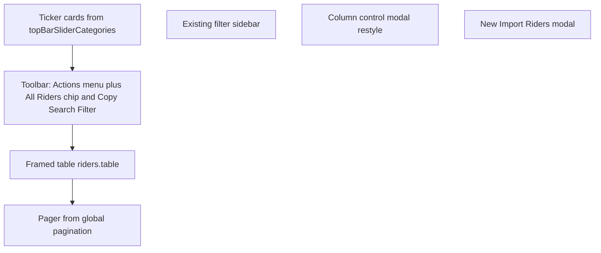

# Rider List redesign (demo match)

Decisions locked: **1B** (demo actions + keep Attendance/Vouchers + new master Import Riders) and **2A** (debounced AJAX quick search; Create still links to `riders.create`).

Reference: `e:\downloads\Riders Page Demo v2 (1).html`.

## What changes vs what stays

**Visual shell** of [`resources/views/riders/index.blade.php`](resources/views/riders/index.blade.php) becomes the demo layout: summary ticker → toolbar → framed sticky table → pager. Tokens and class names from the demo (`.wrap`, `.ticker`, `.toolbar`, `.tbox`, `.pager`, `.ov`/`.modal`, `.toast`).

**Keep wired to existing backend:**

- Top-bar data from `moduleTopBarListingData` / `TopBarListingService` (not hard-coded demo cards). Cards become the demo ticker (auto-scroll, drag, wheel, hover pause, click filter, selected chip, All Riders clears). Filter still uses `rider_top_option_id` (and status params) so permissions and stats stay correct.
- Filter sidebar form (`#filterForm`) and its fields — opened by **Filter Riders** click (not hover). Same GET submit to `riders.index`.
- Column prefs via existing [`components/column-control-panel`](resources/views/components/column-control-panel.blade.php) logic (`user_table_settings` / `riders_table`) and export via `rider.exportCustomizableRiders` (xlsx/csv/pdf). Restyle the panel into the demo modal (visibility, drag order, Show/Hide/Reset, three export buttons).
- Row actions dropdown (edit/delete/contracts) and permissions. Dots button opens that menu instead of a toast.
- Favorites via `POST riders.toggleFavorite` (`users.favorite_rider_ids`). Star on the name cell; list sort groups favorites → active → rest (server order on `index` + `filterAjax`).
- Create → `route('riders.create')`. Attendance and voucher imports stay as extra menu items with existing `show-modal` routes.
- Export All Fields menu item still hits `rider.exportRiders` (permission `riders_export_data_create`).

**Do not** port demo sample data, localStorage columns, client-only create modal, or CDN-only client Excel import that mutates an in-memory array.

## Layout (index)

Replace the current header/card chrome inside `@can('riders_rider_view')` with:

- Hide the layout-level riders top bar for this page only (it is included from [`contentNavbarLayout`](resources/views/layouts/contentNavbarLayout.blade.php)) so cards are not doubled. Pass a flag from `index()` or a view section the layout checks.
- Actions menu (demo SVG items): Create (`riders_rider_create`), Export (`riders_export_data_create`), Import Riders (`riders_rider_create`), then existing Import Today Attendance and Import Rider Vouchers, then Column Control.
- Copy button: clipboard HTML + TSV of the **current page** visible columns (demo `excelHTML` / `plain`), using rendered cell text.
- Search input `#q` debounced (~300ms) → `POST riders.filterAjax` with current query string + `quick_search`, swaps table body + pager, updates “Showing X–Y of Z”.
- Status + status days: keep one Status column visually like the demo (badge + days under it via existing [`_status_badges`](resources/views/riders/_status_badges.blade.php) restyled). Do not invent a separate Status Days column unless it already exists in `buildRidersIndexTableColumns()`.
- Scoped CSS in a new `public/css/riders-list-demo.css` (demo tokens). Do not restyle the global top bar used by other modules.

## Search and ordering (backend)

In [`RidersController::index`](app/Http/Controllers/RidersController.php) and `filterAjax`, extend `quick_search` OR-group to also match:

- nationality (country name subquery)
- personal/company contact
- emirate / person code if those columns exist
- bike plate (`bikes` where `rider_id`)
- status label (map Active/Inactive/etc. through existing status helpers, not only bike warehouse)

Share one private `applyRiderQuickSearch()` so both methods stay identical.

Order: favorites for the current user first (`users.favorite_rider_ids`), then active status, then current sort. Pass `favorited` rider ids into the table for the star state.

`filterAjax` response stays `{ success, html, pagination, total, per_page }` but pagination HTML should match the demo pager markup (Previous / numbered / Next) while still using Laravel page links (`page` query param).

## Master Import Riders

New routes (permission `riders_rider_create`):

- `GET` sample/blank template (xlsx via PhpSpreadsheet, same stack as other exports): importable rider fields only; list columns as dropdowns from real company data (nationality, fleet supervisor, branch, designation). Rules match the demo: Rider Id required; existing id updates only filled cells; new id requires name; dates accepted in the demo formats; nothing saved until confirm.
- `POST` preview: parse xlsx/csv, return JSON rows `{ row, rider_id, action: new|upd|err, changes, problems }`.
- `POST` commit: apply only non-error rows through the same validation/fill path as `store`/`update` (no bypass of status permissions or company scope).

UI: demo Import modal (drop zone, rules, preview table, counts, Choose another file / Import N). Templates: Download sample + Blank template.

Ignored non-importable columns (project, bike, status, balance, company contact) are reported, not written.

## Table markup

Update [`resources/views/riders/table.blade.php`](resources/views/riders/table.blade.php) classes to demo (`thead` sticky, zebra, name link + star, badge, dots menu). Preserve `@fieldVisible`, pending-deletion badge, WhatsApp contact links, and row action URLs. Column visibility/order still driven by saved `user_table_settings` when rendering headers/cells.

## Out of scope

- Profile/show/create form redesign
- Changing top-bar config for other modules
- Client-side search of the full unpaginated dataset
- Replacing `exportCustomizableRiders` / `exportRiders` with ExcelJS CDN
